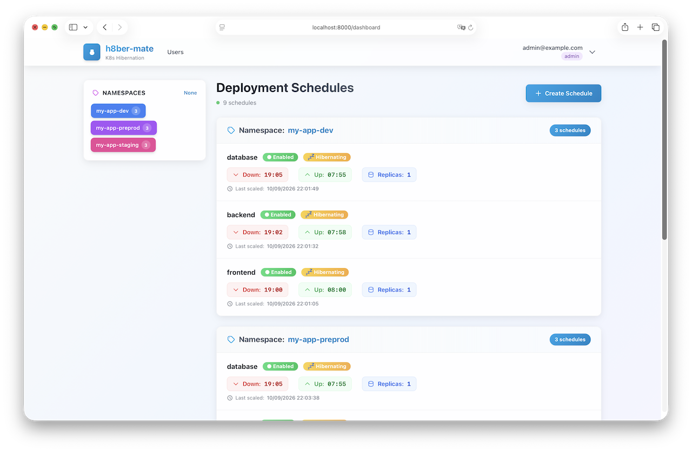

# h8ber-mate



**Intelligent Kubernetes deployment hibernation scheduler**

[](https://github.com/mainmain-rl/h8ber-mate/actions/workflows/tagged-image-publisher.yaml)
[](LICENSE)
[](https://www.python.org/downloads/)
[](https://www.typescriptlang.org/)

All-in-one service to automatically hibernate (scale to 0) your Kubernetes deployments based on time schedules.

[Features](#-features) • [Quick Start](#-quick-start) • [Installation](#-installation) • [Configuration](#-configuration) • [API](#-api) • [Development](#-development)

---

## Overview

**h8ber-mate** automatically scales down Kubernetes deployments during off-hours and scales them back up when needed. Reduce cloud costs and optimize cluster utilization without manual intervention.

**Use cases:**
- Development/staging environments during night hours
- Non-production workloads during weekends
- Cost optimization on cloud providers
- Energy-efficient cluster management

## Features

### Flexible Scheduling
- **Time-based scaling**: Define custom scale-down and scale-up times (HH:MM format)
- **Timezone support**: Configure schedules in your local timezone (e.g., `Europe/Paris`, `US/Central`)
- **Multiple schedules per deployment**: Combine night hibernation with lunch breaks or other windows
- **Preset templates**: Quick setup with common patterns (night, lunch break, evening)
- **Minute-precise execution**: Schedules execute at exactly HH:MM:00

### Security & Control
- **Namespace labeling**: Only namespaces with `h8ber-mate/enabled=true` label can be scheduled
- **Per-deployment control**: Enable/disable schedules individually
- **State restoration**: Automatically restores original replica count
- **Smart enable/disable**: Scales deployments intelligently when toggling schedules
- **Multi-user support**: Role-based access with namespace-scoped permissions
- **API keys**: Programmatic access for automation

### Modern UI
- **Real-time dashboard**: Monitor all schedules at a glance
- **Easy management**: Create, edit, and delete schedules with a clean interface
- **Status tracking**: See which deployments are currently hibernated
- **Responsive design**: Works on desktop, tablet, and mobile

### Production Ready
- **All-in-one deployment**: Single Docker image with backend + frontend
- **In-cluster execution**: Runs directly in your Kubernetes cluster
- **SQLite backend**: Simple, reliable, no external database needed
- **PostgreSQL support**: Production-ready, scalable option
- **Persistent storage**: Survives pod restarts with PersistentVolume
- **Health checks**: Built-in liveness and readiness probes
- **Minimal permissions**: RBAC with least privilege principle
- **Multi-architecture**: Supports AMD64 and ARM64
- **GitOps friendly**: Automatic FluxCD/ArgoCD snooze labels

## Architecture

```
┌──────────────────────────────────────────────────────┐
│                    Kubernetes Cluster                │
│                                                      │
│  ┌───────────────────────────────────────────────┐   │
│  │              h8ber-mate Pod                   │   │
│  │                                               │   │
│  │  ┌──────────────┐        ┌─────────────────┐  │   │
│  │  │   FastAPI    │◄──────►│   React SPA     │  │   │
│  │  │   Backend    │        │   Frontend      │  │   │
│  │  └──────┬───────┘        └─────────────────┘  │   │
│  │         │                                     │   │
│  │         ├─────────► SQLite Database           │   │
│  │         │            (PersistentVolume)       │   │
│  │         │                                     │   │
│  │  ┌──────▼────────┐                            │   │
│  │  │  Scheduler    │                            │   │
│  │  │  (APScheduler)│                            │   │
│  │  └──────┬────────┘                            │   │
│  └─────────┼─────────────────────────────────────┘   │
│            │                                         │
│            ▼                                         │
│  ┌─────────────────────────────────────────────┐     │
│  │        Kubernetes API Server                │     │
│  │  (Scale Deployments via Apps/v1 API)        │     │
│  └─────────────────────────────────────────────┘     │
│                                                      │
└──────────────────────────────────────────────────────┘
```

**Technology Stack**:
- **Backend**: Python 3.13 + FastAPI + APScheduler
- **Frontend**: React + TypeScript + Tailwind CSS
- **Database**: SQLite (default) or PostgreSQL
- **Kubernetes Client**: Official Python kubernetes client
- **Container**: All-in-one Docker image (backend serves static frontend)

## Quick Start

### Prerequisites
- Kubernetes cluster (v1.21+)
- `kubectl` configured to access your cluster
- Cluster-admin permissions (for initial RBAC setup)

### 1. Label your namespaces

Only namespaces with the label `h8ber-mate/enabled=true` can create schedules:

```bash
kubectl label namespace my-dev-namespace h8ber-mate/enabled=true
kubectl label namespace my-staging-namespace h8ber-mate/enabled=true
```

### 2. Deploy h8ber-mate

```bash
kubectl apply -f https://raw.githubusercontent.com/mainmain-rl/h8ber-mate/main/k8s/all-in-one.yaml
```

### 3. Access the UI

```bash
kubectl port-forward -n h8ber-mate svc/h8ber-mate 8000:8000
```

Open **http://localhost:8000**

Default login: `admin` (change via `ADMIN_PASSWORD` environment variable)

### 4. Create your first schedule

1. Select a namespace and deployment
2. Set scale-down and scale-up times
3. Click "Create Schedule"

---

## Installation

### All-in-One Manifest (Recommended)

Deploy everything with a single command:

```bash
kubectl apply -f https://raw.githubusercontent.com/mainmain-rl/h8ber-mate/main/k8s/all-in-one.yaml
```

This creates:
- `h8ber-mate` namespace
- ServiceAccount with RBAC permissions
- PersistentVolumeClaim (1Gi for SQLite database)
- Deployment (all-in-one image)
- ClusterIP Service
- (Optional) Ingress

### Helm Chart (Coming Soon)

```bash
helm repo add h8ber-mate https://h8ber-mate.github.io/charts
helm install h8ber-mate h8ber-mate/h8ber-mate \
  --set admin.password=your-secure-password \
  --set timezone=Europe/Paris
```

---

## Configuration

### Environment Variables

| Variable | Description | Default | Required |
|----------|-------------|---------|----------|
| `DB_TYPE` | Database type: `sqlite` or `postgresql` | `sqlite` | No |
| `SQLITE_PATH` | Path to SQLite database file | `./data/h8ber-mate.db` | No |
| `DB_HOST` | PostgreSQL host | `localhost` | PostgreSQL only |
| `DB_PORT` | PostgreSQL port | `5432` | PostgreSQL only |
| `DB_USER` | PostgreSQL username | `h8ber-mate` | PostgreSQL only |
| `DB_PASSWORD` | PostgreSQL password | - | PostgreSQL only |
| `DB_DB` | PostgreSQL database name | `h8ber-mate` | PostgreSQL only |
| `ADMIN_EMAIL` | Admin user email | `admin@h8ber-mate.local` | No |
| `ADMIN_PASSWORD` | Admin login password | `admin` | No |
| `JWT_SECRET_KEY` | Secret key for JWT tokens | Auto-generated | No |
| `ACCESS_TOKEN_EXPIRE_MINUTES` | JWT token expiration (minutes) | `30` | No |
| `TIMEZONE` | Timezone for schedules | `Europe/Paris` | No |
| `LOG_LEVEL` | Logging level | `INFO` | No |
| `FLUXCD_OPTION` | Add FluxCD snooze label | `false` | No |
| `ARGOCD_OPTION` | Add ArgoCD snooze label | `false` | No |

### Example: SQLite (default)

```yaml
apiVersion: v1
kind: ConfigMap
metadata:
  name: h8ber-mate-config
  namespace: h8ber-mate
data:
  DB_TYPE: "sqlite"
  SQLITE_PATH: "./data/h8ber-mate.db"
  TIMEZONE: "America/New_York"
  LOG_LEVEL: "INFO"
  ADMIN_PASSWORD: "your-secure-password"
```

### Example: PostgreSQL

```yaml
apiVersion: v1
kind: Secret
metadata:
  name: h8ber-mate-secret
  namespace: h8ber-mate
type: Opaque
stringData:
  db-password: "your-db-password"
  admin-password: "your-secure-password"
---
apiVersion: v1
kind: ConfigMap
metadata:
  name: h8ber-mate-config
  namespace: h8ber-mate
data:
  DB_TYPE: "postgresql"
  DB_HOST: "postgres.default.svc.cluster.local"
  DB_PORT: "5432"
  DB_USER: "h8ber-mate"
  DB_DB: "h8ber-mate"
  TIMEZONE: "America/New_York"
  LOG_LEVEL: "INFO"
```

### Resource Requirements

- **CPU**: 100m (requests), 300m (limits)
- **Memory**: 128Mi (requests), 256Mi (limits)
- **Storage**: 100M PersistentVolume for SQLite database

### RBAC Permissions

```yaml
rules:
  - apiGroups: [""]
    resources: ["namespaces"]
    verbs: ["get", "list"]
  - apiGroups: ["apps"]
    resources: ["deployments"]
    verbs: ["get", "list", "patch"]
```

---

## Usage

### 1. Enable Scheduling for a Namespace

```bash
kubectl label namespace my-app h8ber-mate/enabled=true
```

### 2. Create a Schedule

**Via the UI:**

1. Open h8ber-mate in your browser
2. Click **"New Schedule"**
3. Select namespace (only labeled namespaces appear)
4. Select deployment
5. Set scale-down time (e.g., `22:00`)
6. Set scale-up time (e.g., `08:00`)
7. Click **"Create Schedule"**

**Via API:**

```bash
# 1. Login to get token
curl -X POST http://localhost:8000/api/auth/login \
  -H "Content-Type: application/json" \
  -d '{"password": "admin"}'

# 2. Create schedule
curl -X POST http://localhost:8000/api/schedules \
  -H "Authorization: Bearer YOUR_TOKEN" \
  -H "Content-Type: application/json" \
  -d '{
    "namespace": "my-app",
    "deployment_name": "my-deployment",
    "scale_down_time": "22:00",
    "scale_up_time": "08:00"
  }'
```

### 3. Multiple Schedules Per Deployment

Create multiple schedules for the same deployment (e.g., night + lunch):

```bash
# Night schedule: 22:00 - 08:00
curl -X POST http://localhost:8000/api/schedules \
  -H "Authorization: Bearer YOUR_TOKEN" \
  -H "Content-Type: application/json" \
  -d '{"namespace": "my-app", "deployment_name": "my-deployment", "scale_down_time": "22:00", "scale_up_time": "08:00"}'

# Lunch schedule: 13:00 - 14:00
curl -X POST http://localhost:8000/api/schedules \
  -H "Authorization: Bearer YOUR_TOKEN" \
  -H "Content-Type: application/json" \
  -d '{"namespace": "my-app", "deployment_name": "my-deployment", "scale_down_time": "13:00", "scale_up_time": "14:00"}'
```

**Behavior**: Deployment scales down if **any** schedule is active. Scales up only when **no** schedule is active.

### 4. Monitor Schedules

**Dashboard**: Green = enabled, Red = disabled, "Currently scaled down" = hibernated

**Via API:**
```bash
curl http://localhost:8000/api/schedules -H "Authorization: Bearer YOUR_TOKEN"
```

### 5. Edit a Schedule

- **UI**: Click edit icon (✏️)
- **API**: `PATCH /api/schedules/{id}`

**Smart behavior:**
- Disabling a hibernated schedule → scales up immediately
- Enabling during hibernation period → scales down immediately

### 6. Delete a Schedule

Deleting a schedule automatically scales the deployment back to its original replica count if currently hibernated.

---

## How It Works

1. **Schedule Creation**: Saves current replica count as baseline
2. **Periodic Check**: APScheduler evaluates schedules every minute
3. **Scale Down**: At scale-down time, deployment → 0 replicas
4. **Scale Up**: At scale-up time, deployment → original replica count
5. **State Persistence**: All state saved in database (survives restarts)
6. **Timezone Aware**: All times interpreted in configured timezone

### Example Timeline

**Schedule**: Scale down 22:00, Scale up 08:00 (Europe/Paris)

```
07:00 ────► ✅ Running (3 replicas)
22:00 ────► 🌙 Scaled down to 0 (hibernation starts)
23:30 ────► 💤 Still hibernated (0 replicas)
08:00 ────► ☀️ Scaled up to 3 replicas
10:00 ────► ✅ Running normally (3 replicas)
```

---

## API Reference

| Method | Endpoint | Description |
|--------|----------|-------------|
| `POST` | `/api/auth/login` | Authenticate and get JWT token |
| `GET` | `/api/schedules` | List all schedules |
| `POST` | `/api/schedules` | Create a schedule |
| `GET` | `/api/schedules/{id}` | Get schedule details |
| `PATCH` | `/api/schedules/{id}` | Update a schedule |
| `DELETE` | `/api/schedules/{id}` | Delete a schedule |
| `GET` | `/api/users` | List users (admin) |
| `POST` | `/api/users` | Create user (admin) |
| `GET` | `/api/api-keys` | List API keys |
| `POST` | `/api/api-keys` | Create API key |
| `GET` | `/api/health` | Health check |

Full API documentation available at `/api/docs` (Swagger UI) when running.

---

## Development

### Prerequisites
- Python 3.13+
- Node.js 22+
- uv (Python package manager)
- Kubernetes cluster access (for testing)

### Backend

```bash
cd backend
uv sync
uv run python main.py
# API at http://localhost:8000
# Swagger docs at http://localhost:8000/api/docs
```

### Frontend

```bash
cd frontend
npm install
npm run dev
# UI at http://localhost:5173
```

### Testing

```bash
cd backend
uv run pytest tests/test_scheduler.py tests/test_schedule_models.py -v
```

### Build Docker Image

```bash
docker build -t h8ber-mate:dev .
```

---

## Troubleshooting

### Schedule Not Triggering

```bash
# Check scheduler is running
kubectl logs -n h8ber-mate -l app=h8ber-mate -f | grep "Scheduler started"

# Check schedule exists and is enabled
curl http://localhost:8000/api/schedules -H "Authorization: Bearer YOUR_TOKEN"

# Check timezone
kubectl get deployment -n h8ber-mate h8ber-mate -o jsonpath='{.spec.template.spec.containers[0].env[?(@.name=="TIMEZONE")].value}'
```

### Permission Denied

```bash
kubectl auth can-i get deployments --as=system:serviceaccount:h8ber-mate:h8ber-mate -n my-namespace
kubectl auth can-i patch deployments --as=system:serviceaccount:h8ber-mate:h8ber-mate -n my-namespace
```

### Namespace Not in Dropdown

```bash
# Check label exists
kubectl get namespace my-namespace -o jsonpath='{.metadata.labels.h8ber-mate/enabled}'
# Should output: true

# Add if missing
kubectl label namespace my-namespace h8ber-mate/enabled=true
```

### Reset Database (⚠️ deletes all schedules)

```bash
kubectl delete pvc -n h8ber-mate h8ber-mate-data
kubectl delete pod -n h8ber-mate -l app=h8ber-mate
```

---

## Contributing

Contributions welcome! 

1. Clone the repository
2. Create feature branch (`git checkout -b dev-feature/amazing-feature`)
3. Commit changes (`git commit -m 'feat: some amazing feature'`)
4. Push to branch (`git push origin dev-feature/amazing-feature`)
5. Open a Pull Request

---

## License

MIT License - see [LICENSE](LICENSE) for details.

---

## Acknowledgments

- [FastAPI](https://fastapi.tiangolo.com/)
- [React](https://react.dev/)
- [Kubernetes Python Client](https://github.com/kubernetes-client/python)
- [APScheduler](https://apscheduler.readthedocs.io/)
- [Tailwind CSS](https://tailwindcss.com/)

---

## Support

- [Documentation](https://github.com/mainmain-rl/h8ber-mate/wiki)
- [Issue Tracker](https://github.com/mainmain-rl/h8ber-mate/issues)
- [Discussions](https://github.com/mainmain-rl/h8ber-mate/discussions)

---

<div align="center">

Made for the Kubernetes community

⭐ Star us on GitHub if you find this project useful!

</div>